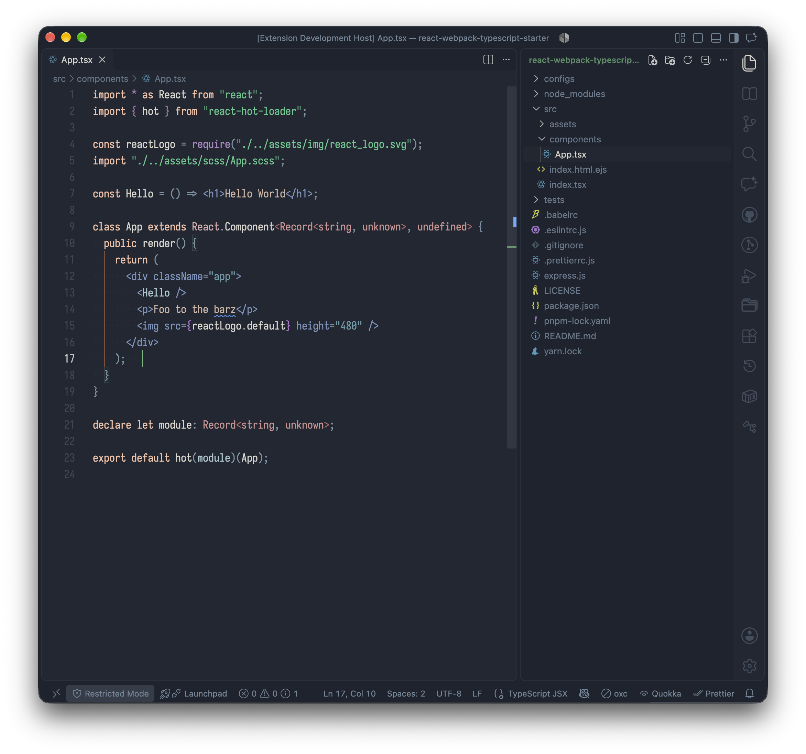
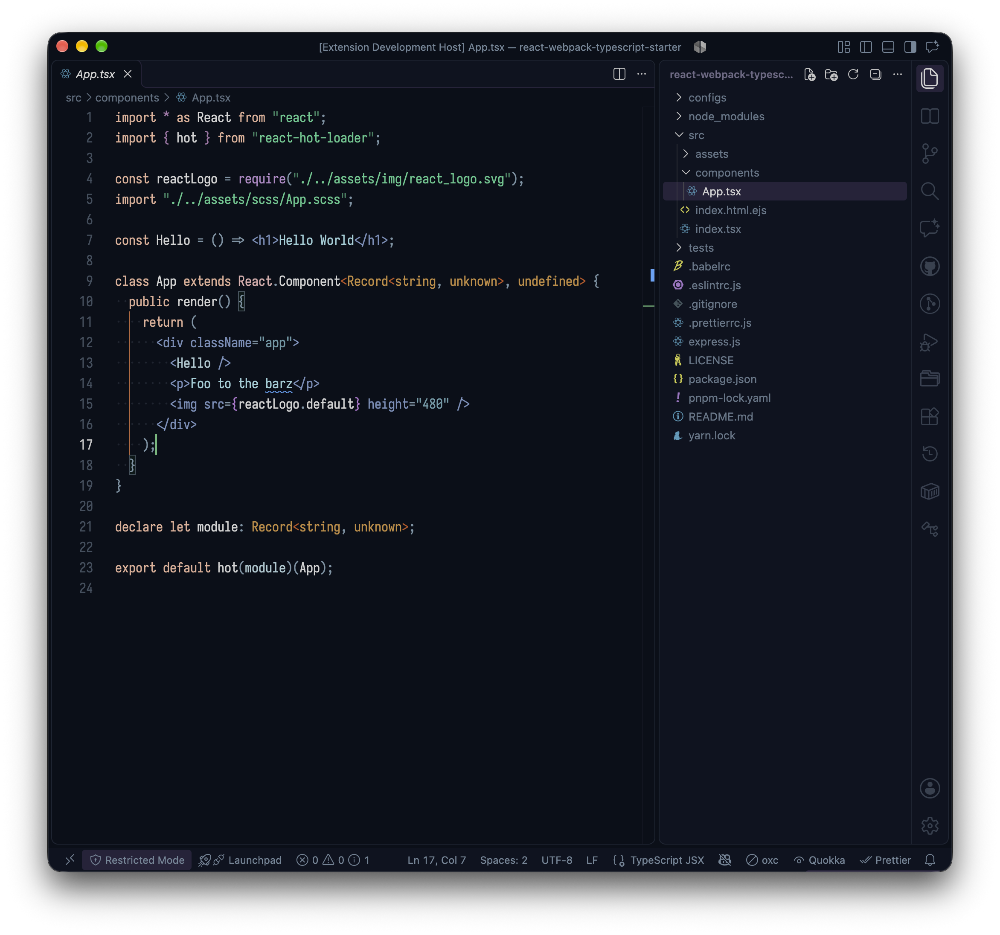

# Nada Theme
Two dark themes full of nada.

Made for Typescript, Javascript, React, Svelte, Rust CSS, SASS, Python, and many others.

## Themes

Pick one with `Cmd+K Cmd+T` (`Ctrl+K Ctrl+T` on Windows/Linux), or open **Preferences: Color Theme** from the Command Palette.

| Theme | Description |
| --- | --- |
| **Nada** | The original. A slate-blue dark theme. |
| **Nada Night** | A deeper, darker take with a cyan accent, softer text, and extra polish for Markdown preview, diffs, and TypeScript types. |

### Nada

### Nada Night

Elements of these themes are inspired by *Dracula* and *Field Lights* themes. 

&copy; Adan Perez 2026
